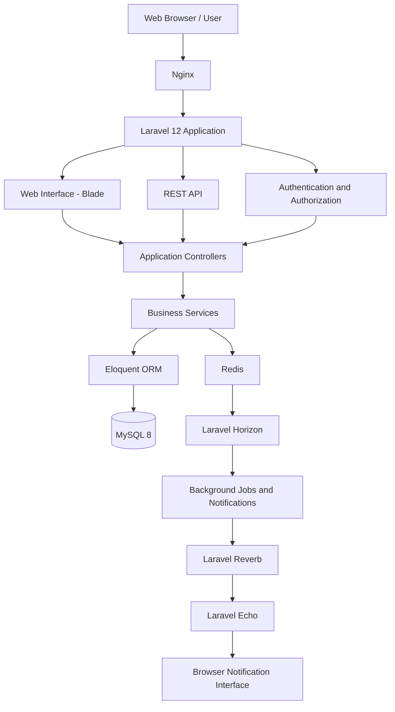
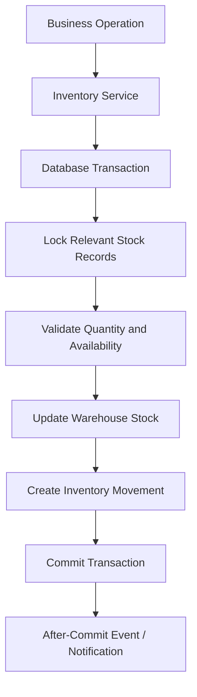
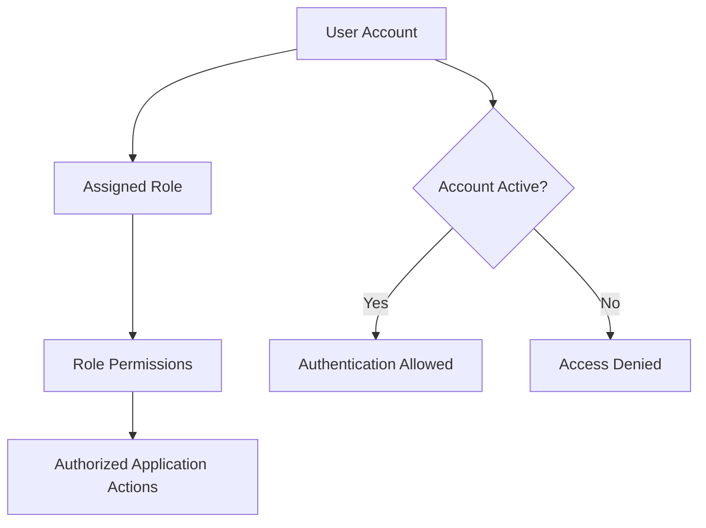
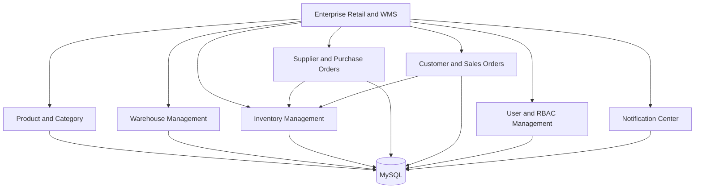
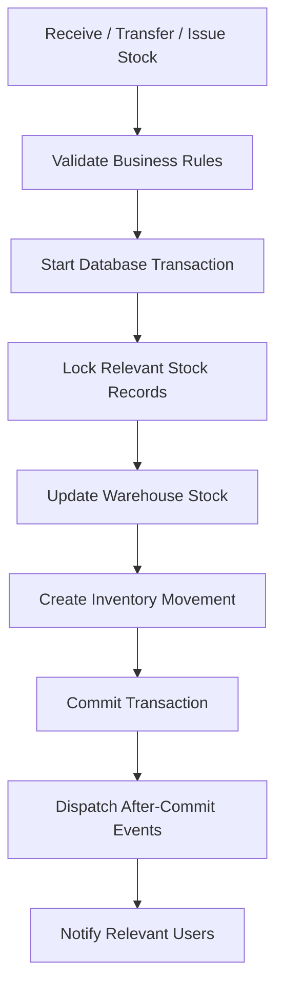
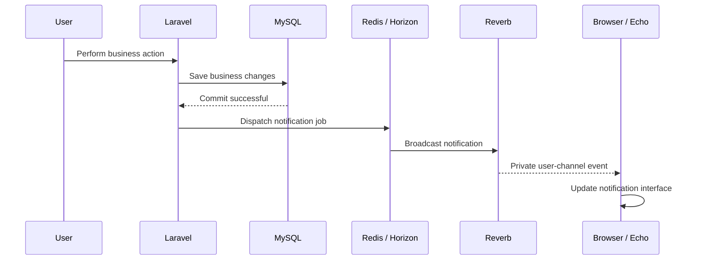

# Enterprise Retail & Warehouse Management System

A Laravel-based Retail and Warehouse Management System (WMS) for managing products, warehouses, inventory, procurement, sales orders, and operational workflows through a centralized web application.

The project is designed around maintainable application architecture, controlled inventory operations, role-based access control, transactional data integrity, and real-time operational notifications.

**Project status:** Active development.

---

## 1. Project Overview

The Enterprise Retail & Warehouse Management System provides a centralized platform for managing retail and warehouse operations.

The application brings together product catalog management, warehouse administration, inventory tracking, supplier and purchase order workflows, customer and sales order management, user administration, and notifications.

The system follows a **modular monolith architecture**: business responsibilities are organized into separate application modules while sharing a single Laravel application and relational database.

### Key objectives

-   Centralize product, warehouse, and inventory information.
-   Maintain accurate warehouse-level stock balances.
-   Track stock movements and operational history.
-   Support purchase order creation, approval, and receiving.
-   Manage customer sales orders and fulfillment.
-   Enforce role-based access to business operations.
-   Provide operational notifications and real-time updates.
-   Maintain data integrity through database transactions and validation.

## 2. Technology Stack

| Category                | Technology                      |
| ----------------------- | ------------------------------- |
| Backend Framework       | Laravel 12                      |
| Programming Language    | PHP 8.4                         |
| Database                | MySQL 8                         |
| ORM                     | Laravel Eloquent                |
| Frontend                | Blade, HTML, CSS, JavaScript    |
| Frontend Build Tool     | Vite                            |
| Authentication          | Laravel Authentication, Sanctum |
| Authorization           | Spatie Laravel Permission       |
| Queue Infrastructure    | Redis                           |
| Queue Monitoring        | Laravel Horizon                 |
| Real-Time Communication | Laravel Reverb                  |
| Browser Event Client    | Laravel Echo                    |
| Web Server              | Nginx                           |
| PHP Runtime             | PHP-FPM                         |
| Containerization        | Docker, Docker Compose          |
| Version Control         | Git, GitHub                     |

## 3. System Architecture

The application uses a modular monolith architecture with clear separation between the presentation, application, business, data, and infrastructure responsibilities.

### 3.1 High-Level Architecture



### 3.2 Application Layers

| Layer          | Responsibility                                          |
| -------------- | ------------------------------------------------------- |
| Presentation   | Blade views, forms, dashboard, and browser interactions |
| HTTP           | Routes, controllers, request validation, and middleware |
| Application    | Coordinates business workflows and service calls        |
| Business       | Inventory operations and domain rules                   |
| Data           | Eloquent models, relationships, migrations, and MySQL   |
| Infrastructure | Redis, Horizon, Reverb, Nginx, and Docker               |

Controllers should coordinate requests rather than contain duplicated business rules. Shared business operations should be handled by application or domain services.

## 4. Application Modules

### 4.1 Product and Category Management

Manages the product catalog used throughout the system.

Capabilities include:

-   Create, view, update, and delete products.
-   Maintain product information and SKU identifiers.
-   Organize products into categories.
-   Provide product information to purchasing, inventory, and sales workflows.

### 4.2 Warehouse Management

Manages warehouse records and warehouse-level organization.

Capabilities include:

-   Create and manage warehouses.
-   Maintain warehouse information and status.
-   Manage warehouse locations.
-   Associate stock balances with the appropriate warehouse.

### 4.3 Inventory Management

Provides centralized visibility and control over inventory.

Capabilities include:

-   View warehouse-level stock balances.
-   Receive stock into warehouses.
-   Transfer stock between warehouses.
-   Issue stock for sales fulfillment.
-   Record inventory movements.
-   Track stock history and reorder thresholds.

**Inventory integrity principle:** Stock-changing operations must go through controlled inventory services. A stock balance update should be accompanied by the corresponding inventory movement record.

### 4.4 Supplier Management

Maintains supplier information for procurement operations.

Capabilities include:

-   Create and maintain supplier records.
-   Search and view supplier information.
-   Manage supplier account status.
-   Associate suppliers with purchase orders.

### 4.5 Purchase Order Management

Supports purchasing workflows from order creation through receiving.

Capabilities include:

-   Create and update purchase orders.
-   Maintain purchase order items and quantities.
-   Submit purchase orders for approval.
-   Support approval workflows.
-   Receive purchased goods.
-   Update warehouse inventory through the receiving process.
-   Track purchase order status and receiving progress.

### 4.6 Customer Management

Maintains customer information used by sales operations.

Capabilities include:

-   Create and manage customer records.
-   Search and view customer information.
-   Manage active and inactive customer accounts.
-   Associate customers with sales orders.

### 4.7 Sales Order Management

Manages customer orders and their operational lifecycle.

Capabilities include:

-   Create and manage sales orders.
-   Maintain order items and pricing information.
-   View and update order details.
-   Confirm and process orders.
-   Complete or cancel orders.
-   Record order status history.
-   Issue warehouse stock when an order is completed.

The current fulfillment design checks stock availability during completion. Stock reservation at order confirmation is a separate enhancement.

### 4.8 User Management and Access Control

Provides administrative management of application accounts.

Capabilities include:

-   Create and update users.
-   Assign roles and permissions.
-   Activate and deactivate user accounts.
-   View user details and effective permissions.
-   Restrict access to privileged accounts.
-   Prevent inactive accounts from authenticating.

### 4.9 Notification Center and Real-Time Communication

Provides operational notifications through the application.

The notification infrastructure uses:

-   Laravel Notifications for application notifications.
-   Database notifications for persistent notification history.
-   Redis for queue infrastructure.
-   Laravel Horizon for background job supervision.
-   Laravel Reverb for WebSocket broadcasting.
-   Laravel Echo for browser-side event subscriptions.

Notifications can be associated with business events such as purchase order activity, inventory operations, and sales order completion, depending on the configured notification triggers and recipients.

## 5. Inventory and Transaction Design

Inventory is a critical business domain. Stock balances and movement records must remain consistent.

### 5.1 Core Inventory Entities

| Entity             | Responsibility                                   |
| ------------------ | ------------------------------------------------ |
| Product            | Defines the item being tracked                   |
| Warehouse          | Represents a stock-holding location              |
| Warehouse Stock    | Stores product quantity for a warehouse          |
| Inventory Movement | Records stock operations and their history       |
| User               | Identifies the user responsible for an operation |

### 5.2 Inventory Operation Flow



### 5.3 Supported Stock Operations

| Operation  | Inventory Effect                                             |
| ---------- | ------------------------------------------------------------ |
| Receive    | Increases stock                                              |
| Issue      | Decreases stock                                              |
| Transfer   | Decreases source stock and increases destination stock       |
| Adjustment | Changes stock according to an authorized adjustment workflow |

### 5.4 Data Integrity Rules

-   Validate stock quantities before performing operations.
-   Prevent issuing more stock than is available.
-   Use database transactions for multi-record operations.
-   Lock relevant stock records when concurrent updates are possible.
-   Record inventory movements for traceability.
-   Associate movements with the relevant warehouse, product, and user where applicable.
-   Dispatch notifications and broadcasts after successful transaction commits.

## 6. Authentication and Authorization

The application uses Laravel authentication and Spatie Laravel Permission for role-based access control (RBAC).

### 6.1 Authorization Model



A role groups related permissions. Individual permissions determine which actions a user can perform.

### 6.2 Seeded Roles

The current role seeder defines seven roles:

1. Super Admin
2. Admin
3. Warehouse Manager
4. Warehouse Staff
5. Sales Manager
6. Sales Staff
7. Accountant

### 6.3 Permission Examples

| Permission                | Description                               |
| ------------------------- | ----------------------------------------- |
| `dashboard.view`          | View the dashboard                        |
| `products.view`           | View products                             |
| `products.create`         | Create products                           |
| `products.edit`           | Update products                           |
| `inventory.view`          | View inventory                            |
| `inventory.receive`       | Receive stock                             |
| `inventory.transfer`      | Transfer stock                            |
| `purchase-orders.view`    | View purchase orders                      |
| `purchase-orders.approve` | Approve purchase orders                   |
| `sales-orders.view`       | View sales orders                         |
| `sales-orders.create`     | Create sales orders                       |
| `users.view`              | View users                                |
| `users.create`            | Create users                              |
| `roles.manage`            | Manage role and permission administration |

The role and permission definitions are maintained in `database/seeders/RolesAndPermissionsSeeder.php`.

### 6.4 Security Controls

-   Enforce authorization on server-side routes and actions.
-   Restrict privileged role assignment to authorized administrators.
-   Protect privileged user accounts from unauthorized management.
-   Prevent deactivated accounts from logging in.
-   Check account status during authenticated web requests.
-   Protect the last active Super Admin account from accidental deactivation.

## 7. Database Design

MySQL is the primary persistence layer. Laravel Eloquent manages database interactions and entity relationships.

The database schema is maintained through Laravel migrations.

### 7.1 Main Business Entities

-   Users
-   Roles and Permissions
-   Products
-   Categories
-   Warehouses
-   Warehouse Locations
-   Warehouse Stocks
-   Inventory Movements
-   Suppliers
-   Purchase Orders
-   Purchase Order Items
-   Customers
-   Sales Orders
-   Sales Order Items
-   Sales Order Status Histories
-   Notifications

### 7.2 Database Design Principles

-   Use foreign keys for referential integrity.
-   Add indexes for frequently searched and filtered fields.
-   Enforce appropriate unique constraints.
-   Use transactions for related business writes.
-   Preserve operational history where auditability is required.
-   Apply schema changes incrementally through migrations.
-   Avoid destructive database operations in environments containing important data.

## 8. Docker Infrastructure

The application runs through Docker Compose.

| Service  | Responsibility                         |
| -------- | -------------------------------------- |
| `app`    | Laravel application running on PHP-FPM |
| `nginx`  | HTTP entry point and reverse proxy     |
| `mysql`  | Relational database                    |
| `redis`  | Queue infrastructure                   |
| `queue`  | Laravel Horizon queue supervision      |
| `reverb` | WebSocket broadcasting server          |

### 8.1 Local Development Endpoints

| Service         | Local Endpoint          |
| --------------- | ----------------------- |
| Web Application | `http://localhost:8081` |
| Reverb          | `http://localhost:8082` |
| MySQL           | `localhost:3307`        |

Container-to-container communication uses the Docker Compose service names and internal ports. For example, the Laravel application connects to MySQL and Redis through their Docker service hostnames rather than their host-mapped ports.

## 9. Installation and Local Development

### 9.1 Prerequisites

-   Git
-   Docker Desktop or Docker Engine
-   Docker Compose
-   Node.js and npm for frontend asset compilation

The documented backend workflow runs PHP and MySQL inside Docker, so installing PHP locally is not required.

### 9.2 Clone the Repository

```bash
git clone <repository-url>
cd retail-wms
```

### 9.3 Configure Environment

```bash
cp .env.example .env
```

Configure the required application, database, Redis, and broadcasting variables in `.env`.

For Docker-based communication, use the appropriate Compose service names for database, Redis, and Reverb connections.

Do not commit `.env`, passwords, API keys, or other production secrets to Git.

### 9.4 Build and Start Containers

```bash
docker compose up -d --build
```

### 9.5 Install Backend Dependencies

```bash
docker compose exec app composer install
```

### 9.6 Generate the Application Key

```bash
docker compose exec app php artisan key:generate
```

Only generate a new key when initializing a new environment. Do not casually replace an existing production application key.

### 9.7 Run Database Migrations

```bash
docker compose exec app php artisan migrate
```

### 9.8 Seed Roles and Permissions

```bash
docker compose exec app php artisan db:seed --class=RolesAndPermissionsSeeder
```

Run seeders according to the environment's initialization procedure. Confirm that a seeder is safe to rerun before executing it against an existing database.

### 9.9 Install and Build Frontend Assets

```bash
npm install
npm run build
```

### 9.10 Clear Application Caches

```bash
docker compose exec app php artisan optimize:clear
```

### 9.11 Open the Application

```text
http://localhost:8081
```

## 10. Common Development Commands

### Docker Services

```bash
# Start services
docker compose up -d

# Stop services without deleting persistent volumes
docker compose down

# View running services
docker compose ps

# View application logs
docker compose logs -f app

# View all service logs
docker compose logs -f
```

### Laravel Commands

```bash
# Check Laravel version
docker compose exec app php artisan --version

# List routes
docker compose exec app php artisan route:list

# Check migrations
docker compose exec app php artisan migrate:status

# Clear cached configuration and views
docker compose exec app php artisan optimize:clear

# Run tests
docker compose exec app php artisan test
```

### Queue and Realtime Operations

```bash
# Check Horizon
docker compose exec app php artisan horizon:status

# Monitor Redis queue
docker compose exec app php artisan queue:monitor redis:default --max=10

# List failed jobs
docker compose exec app php artisan queue:failed

# Restart Horizon workers gracefully
docker compose exec app php artisan horizon:terminate
```

### Frontend

```bash
# Install dependencies
npm install

# Development server
npm run dev

# Production build
npm run build
```

## 11. Project Structure

```text
retail-wms/
├── app/
│   ├── Http/
│   │   ├── Controllers/
│   │   ├── Middleware/
│   │   └── Requests/
│   ├── Models/
│   ├── Notifications/
│   └── Services/
│
├── bootstrap/
├── config/
├── database/
│   ├── migrations/
│   ├── seeders/
│   └── factories/
│
├── public/
│   ├── css/
│   └── build/
│
├── resources/
│   ├── js/
│   ├── css/
│   └── views/
│
├── routes/
│   ├── api.php
│   └── web.php
│
├── tests/
├── docker/
├── Dockerfile
├── docker-compose.yml
├── composer.json
├── package.json
└── README.md
```

The structure represents the main application areas. Individual files and modules may evolve as the system develops.

## 12. Security and Engineering Practices

The project follows these engineering principles:

### Application Security

-   Keep credentials and secrets outside source control.
-   Validate and sanitize user input.
-   Enforce server-side authentication and authorization.
-   Apply least-privilege role and permission assignments.
-   Protect sensitive business operations.
-   Use secure cookie and session settings appropriate to the deployment environment.

### Data Integrity

-   Use database transactions for multi-step operations.
-   Apply database constraints and indexes.
-   Lock inventory records where concurrent changes are possible.
-   Maintain inventory movement history.
-   Avoid direct stock changes outside controlled business services.

### Maintainability

-   Keep controllers focused on HTTP responsibilities.
-   Reuse domain services for shared business operations.
-   Use migrations for database changes.
-   Keep frontend assets organized.
-   Use meaningful Git commits.
-   Test critical business workflows before deployment.

### Operational Reliability

-   Monitor queue workers and failed jobs.
-   Review application logs.
-   Verify database backups and recovery procedures.
-   Use after-commit handling for events that depend on committed business data.
-   Monitor WebSocket and queue infrastructure independently.

## 13. Engineering Roadmap

The following roadmap distinguishes existing foundations from enhancements that require further implementation or verification.

| Priority | Enhancement                                           | Status      |
| -------- | ----------------------------------------------------- | ----------- |
| P1       | Laravel and Docker foundation                         | Implemented |
| P1       | Product and warehouse management foundation           | Implemented |
| P1       | Inventory receiving and transfer services             | Implemented |
| P1       | Inventory movement history                            | Implemented |
| P1       | Purchase order workflows                              | Implemented |
| P1       | Sales order workflows                                 | Implemented |
| P1       | User management and account activation                | Implemented |
| P1       | Role and permission foundation                        | Implemented |
| P1       | Notification center and realtime infrastructure       | Implemented |
| P2       | Comprehensive automated business workflow tests       | Enhancement |
| P2       | Complete role and permission administration interface | Enhancement |
| P2       | API Resources and standardized API error contracts    | Enhancement |
| P2       | Inventory reconciliation and audit reporting          | Enhancement |
| P3       | Stock reservation at sales order confirmation         | Planned     |
| P3       | Idempotency protection for stock operations           | Planned     |
| P3       | Reliable event delivery using an outbox pattern       | Planned     |
| P3       | Advanced notification preferences and delivery rules  | Planned     |
| P4       | CI/CD pipeline                                        | Planned     |
| P4       | Production monitoring and alerting                    | Planned     |
| P4       | Automated backup and recovery validation              | Planned     |

## 14. Deployment Considerations

The local Docker Compose environment is intended for development. A production deployment requires additional configuration and operational controls.

Recommended production considerations:

1. Provision a supported Linux server or managed container platform.
2. Configure secure SSH access and firewall rules.
3. Configure Nginx and HTTPS/TLS.
4. Store production secrets in a secure environment or secret manager.
5. Use a managed or properly secured MySQL deployment.
6. Configure Redis and queue worker supervision.
7. Configure Reverb and WebSocket connectivity.
8. Run database migrations as a controlled deployment step.
9. Build frontend assets for production.
10. Configure log collection, monitoring, and alerting.
11. Establish automated database backups and recovery procedures.
12. Test the deployment and rollback process.

Example production commands, to be executed only as part of a reviewed deployment:

```bash
composer install --no-dev --optimize-autoloader

php artisan migrate --force

php artisan config:cache
php artisan route:cache
php artisan view:cache
```

These are deployment recommendations, not a statement that production infrastructure has already been configured.

## 15. System Architecture Map

This section summarizes how business modules and infrastructure services interact.

### 15.1 Business Module Architecture



### 15.2 Inventory Operation Flow



### 15.3 Real-Time Notification Flow



### 15.4 Infrastructure Responsibilities

| Component      | Responsibility                     |
| -------------- | ---------------------------------- |
| Nginx          | HTTP request handling              |
| Laravel        | Business application and workflows |
| MySQL          | Persistent relational data         |
| Redis          | Queue infrastructure               |
| Horizon        | Background worker supervision      |
| Reverb         | WebSocket broadcasting             |
| Echo           | Browser event subscriptions        |
| Docker Compose | Local service orchestration        |

## 16. Engineering Philosophy

This project is built around the idea that a business-critical retail and warehouse application must do more than provide CRUD screens.

It must maintain accurate inventory, enforce business rules, preserve operational history, protect sensitive actions, and provide reliable communication between application components.

The main engineering priorities are:

-   Data integrity over convenience.
-   Controlled business operations over duplicated logic.
-   Clear authorization boundaries.
-   Maintainable modular architecture.
-   Transactional consistency.
-   Operational traceability.
-   Incremental and safe development.

**Built with Laravel 12, PHP 8.4, MySQL, Redis, Docker, and modern application engineering practices.**
